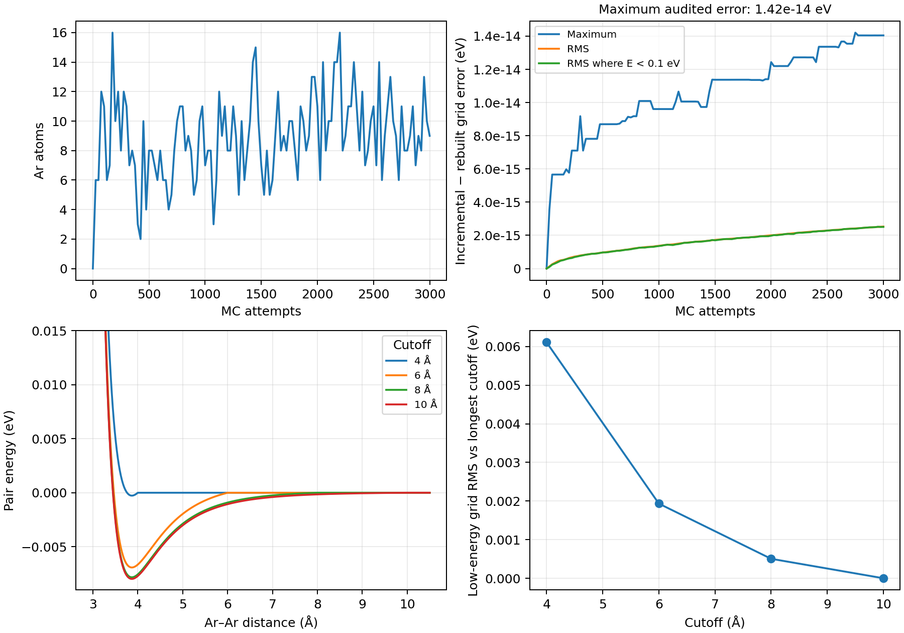

Iterative Ar Monte Carlo
========================

This example starts with an empty periodic box and updates the insertion grid
as Ar atoms enter and leave. **2627 accepted updates over 3000 MC attempts
agreed with full regeneration to within 1.5e-14 eV**. The incremental grid was
never reset.
Cutoff choice had a much larger effect: the low-energy RMS difference between
8 and 10 Angstrom cutoffs was 0.50 meV for the final snapshot.

Run from the repository root:

.. code-block:: bash

   python examples/insertion/argon_gcmc.py --steps 3000 --audit-every 25 \
       --output argon_gcmc.npz --report argon_gcmc.json --plot argon_gcmc.png

.. list-table:: Run settings
   :header-rows: 1
   :widths: 35 65

   * - Parameter
     - Value
   * - Initial state
     - Empty 20 x 20 x 20 Angstrom periodic box
   * - Moves
     - Equally likely insertion or deletion; uniform choice of atom for deletion
   * - Temperature / activity
     - 150 K / 0.001 Angstrom^-3
   * - Reservoir fugacity / ideal-gas pressure
     - 20.71 bar
   * - Chemical potential (classical Ar reference)
     - -0.14704 eV per atom; Ar mass 39.948 u
   * - Pair model
     - UFF Ar; energy-shifted LJ; 10 eV cap per pair; no tail correction
   * - MC cutoff / grid spacing
     - 8 Angstrom / 0.5 Angstrom
   * - Insertion proposals
     - 95% grid Boltzmann bias + 5% uniform
   * - Audits
     - Every 25 attempts, including rejected moves; no grid resets
   * - Cutoff comparison
     - 4, 6, 8, 10 Angstrom on the same final configuration
   * - Seed
     - 42

Finite Core and Cutoff
----------------------

The example uses

.. math::

   u(r) = \begin{cases}
       \min(10\,\mathrm{eV},\ u_{LJ}(r)-u_{LJ}(r_c)), & r < r_c,\\
       0, & r \geq r_c.
   \end{cases}

At r = 0 the pair energy is 10 eV. The cap is applied **before summing pairs**;
a voxel's total energy can exceed 10 eV. This keeps subtraction finite without
rescaling the attractive energies. The energy approaches zero continuously at
the cutoff and is exactly zero at and beyond it. The force is not shifted.
This is an energy-shifted LJ potential, as in the
`LAMMPS shift convention <https://docs.lammps.org/pair_modify.html>`_.

.. code-block:: python

   import numpy as np
   from atomvoxelizer import VoxelGrid, lj_pair_energy, uff_parameters

   cell = np.eye(3) * 20
   grid = VoxelGrid(cell, resolution=0.5, dtype=np.float64)
   position = [10.1, 10.2, 10.3]
   pair = uff_parameters("Ar")
   assert lj_pair_energy(0.0, pair, 8.0, shift=True, energy_cap=10.0) == 10.0
   assert lj_pair_energy(8.0, pair, 8.0, shift=True, energy_cap=10.0) == 0.0

   def mask(distances):
       return lj_pair_energy(distances, pair, 8.0, shift=True, energy_cap=10.0)

   grid.add_sphere(position, 8.0, mask=mask)            # Accepted insertion
   grid.add_sphere(position, 8.0, value=-1, mask=mask)  # Accepted deletion

``shift`` and ``energy_cap`` are optional. Their defaults retain the earlier
unshifted, singular LJ model. The example uses the capped, shifted model for
both its grid and its actual MC energies. Calculations use float64.

Update and Audit
----------------

The example defines a radial LJ mask and applies it with NumPy's
``VoxelGrid.add_sphere``. No box-sized contribution or candidate energy grid is
allocated for an MC move. Mask work arrays cover only the local sphere and are
processed in bounded chunks.

A deletion temporarily subtracts the local mask to evaluate its reverse proposal
density. Only the touched voxel values are saved; a rejected trial restores
those values by assignment, avoiding roundoff from subtracting and adding back.
Proposal normalization still uses box-sized probability arrays.

Every 25 attempts, a separate grid is rebuilt using the same ``add_sphere``
operation for each current atom. This is the only full regeneration in the MC
loop, and the audit never replaces the accumulated grid.

.. list-table:: Largest discrepancies across all audits
   :header-rows: 1

   * - Metric
     - Result
   * - Maximum absolute grid error
     - 1.42e-14 eV
   * - Whole-grid RMS error
     - 2.53e-15 eV
   * - RMS error where rebuilt E < 0.1 eV
     - 2.52e-15 eV
   * - Sum of absolute differences in voxel probabilities
     - 1.43e-13

The errors accumulate at floating-point precision, far below the meV scale of
the attractive field. For this run, incremental addition/subtraction preserves
the full-regeneration result, including weak-energy regions.

Cutoff Sensitivity
------------------

The following comparison freezes the final nine-atom configuration. Differences
include both the omitted tail and the cutoff-dependent energy shift.

.. list-table:: Grid difference from the 10 Angstrom cutoff
   :header-rows: 1

   * - Cutoff (Angstrom)
     - Whole-grid RMS (meV)
     - RMS where reference E < 0.1 eV (meV)
   * - 4
     - 6.84
     - 6.11
   * - 6
     - 2.01
     - 1.93
   * - 8
     - 0.51
     - 0.50
   * - 10
     - 0
     - 0

A short cutoff changes the attractive field appreciably; this error dominates
update drift. The 10 Angstrom field is a comparison reference, not a converged
infinite-cutoff result. Each pair curve is exactly zero at its own cutoff.

MC Acceptance
-------------

The input is activity, z = exp(beta*mu)/Lambda^3, with the monatomic thermal
wavelength Lambda = h / sqrt(2*pi*m*k_B*T). At 150 K and Ar mass 39.948 u,
Lambda = 0.22553 Angstrom and mu = k_B*T*ln(z*Lambda^3) = -0.14704 eV.
The energy reference is an isolated Ar atom with zero potential energy.

The reservoir fugacity is f = z*k_B*T = 20.71 bar. This equals pressure for an
ideal reservoir. For a nonideal reservoir f = phi*P; converting to pressure
requires a fugacity coefficient or an equation of state. It is not a measured
pressure of the simulated box. These definitions follow the
`standard GCMC convention <https://docs.lammps.org/fix_gcmc.html>`_, using the
`Ar mass tabulated by NIST <https://webbook.nist.gov/cgi/cbook.cgi?Name=Argon>`_.

Let N be the atom count **before the attempted move**, and q_N(r) the insertion
proposal density in the current configuration. With equal insertion/deletion
attempt probabilities and uniform selection of an atom for deletion:

.. math::

   A_{\mathrm{ins}} = \min\left(1,
       \frac{z}{(N+1)q_N(\mathbf r)}
       e^{-\beta\Delta U_{\mathrm{ins}}}\right),
   \qquad \Delta U_{\mathrm{ins}} = U_{N+1}-U_N,

.. math::

   A_{\mathrm{del}} = \min\left(1,
       \frac{N q_{N-1}(\mathbf r)}{z}
       e^{-\beta\Delta U_{\mathrm{del}}}\right),
   \qquad \Delta U_{\mathrm{del}} = U_{N-1}-U_N.

For deletion, q_{N-1} is evaluated in the configuration **without the deleted
atom**. The prefactor is N, because the reverse insertion into N-1 atoms has
denominator (N-1)+1 = N. For uniform proposals, q = 1/V, recovering the usual
insertion factor z*V/(N+1) and deletion factor N/(z*V).

In the code, ``removed_energy`` is U_N-U_{N-1}, so its deletion exponent is
``+beta*removed_energy``. Tests check the actual kernel's acceptance thresholds
in both directions for an interacting pair of configurations, the reverse
density after removing an atom, and the ideal-gas limit.

Empty-box deletions are rejected; move selection remains 50/50. Energies use
actual positions and the same capped, shifted potential in both directions.
The MC example restricts the cutoff to half the cubic box length or less, so
each pair has one contributing image.

The NPZ file stores final positions and both grids. The
:download:`full report <_static/argon_gcmc.json>` records every audit, accepted
move counts, and cutoff differences. This run validates incremental grid
updates; it does not establish equilibration or a sampling-efficiency gain.
