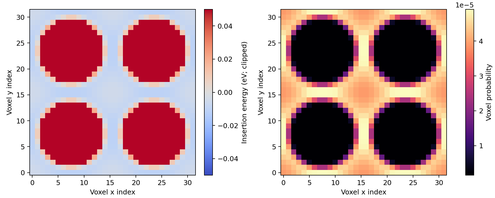
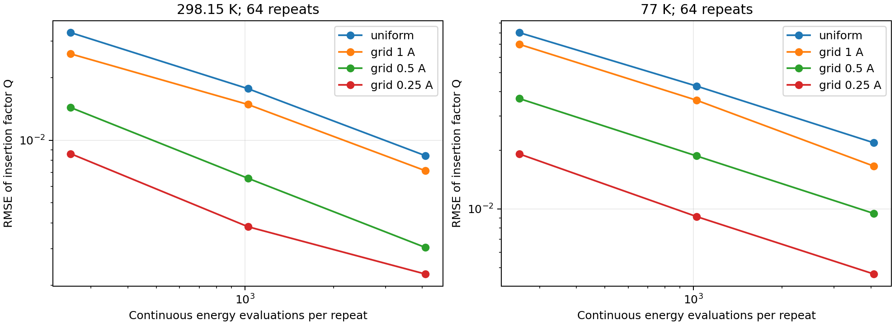

Single-Atom Insertion Bias
==========================

Version 1.1 introduced a NumPy reference implementation of a single-site
Lennard-Jones insertion field. Version 1.2 supports triclinic cells using
atom-centered LJ spheres. It can help propose low-energy positions for
energy-biased Monte Carlo in a fixed host. It needs no additional dependencies
for grid construction or sampling.

Quick Example
-------------

.. code-block:: python

   import numpy as np
   from atomvoxelizer import lj_insertion_grid, insertion_probabilities

   energy = lj_insertion_grid(
       np.eye(3) * 20, [[10.1, 10.2, 10.3]], ["Si"], probe="Ar",
       resolution=0.5, cutoff=8.0,
   )
   probability = insertion_probabilities(energy.grid, temperature=298.15)
   rng = np.random.default_rng(42)
   flat_index = rng.choice(probability.size, p=probability.ravel())
   index = np.array(np.unravel_index(flat_index, energy.grid.shape))
   position = ((index + rng.random(3)) / energy.gpts) @ energy.cell
   voxel_volume = abs(np.linalg.det(energy.cell)) / probability.size
   proposal_density = probability.ravel()[flat_index] / voxel_volume

The example ``examples/insertion/uff_argon.py`` runs offline using an eight-site
carbon cage. It writes an NPZ archive containing ``energy_ev``, ``probability``,
``cell``, ``gpts``, ``temperature_k``, ``probe``, ``cutoff_angstrom``,
``uniform_fraction``, ``samples_angstrom``, and
``proposal_density_per_angstrom3``. For example:

.. code-block:: bash

   python examples/insertion/uff_argon.py --resolution 0.5 --samples 1000 \
       --output argon_insertion.npz --plot argon_insertion.png

To use an existing fully periodic structure, install
``AtomVoxelizer[examples]`` and pass its path as the positional argument:

.. code-block:: bash

   python examples/insertion/uff_argon.py framework.cif --probe Ar --cutoff 8

Sampling Efficiency: A Reproducible Experiment
-----------------------------------------------

Does the bias actually save energy evaluations? The offline benchmark
``benchmarks/benchmark_insertion_sampling.py`` compares uniform insertion with
three grid resolutions in the same eight-carbon cage shown above. It estimates
the dimensionless single-particle insertion factor

.. math::

   Q = \frac{1}{V} \int_V e^{-E(\mathbf{r})/(k_B T)}\,d\mathbf{r}.

This is the configurational factor used in a Widom insertion calculation for a
fixed host and a single-site probe. Its excess chemical potential is
``-k_B T log(Q)``. The benchmark reports Q, avoiding the finite-sample bias
introduced by taking a logarithm of a noisy estimate.

For uniform proposals each contribution is simply ``exp(-E / (k_B T))``.
For biased proposals it is ``exp(-E / (k_B T)) / (V * q(position))``.
Both estimators target the same integral. Omitting this density correction
changes the answer even if the sampled positions look more favorable.

The benchmark samples a voxel, jitters uniformly inside it, and recomputes the
continuous Ar-C LJ energy at that position. Thus the grid is an approximate
proposal, rather than the energy model used for the final evaluation. A 5%
uniform component covers the **entire cell**, including voxels whose centers
have infinite energy. This differs from the finite-voxel uniform component in
``insertion_probabilities`` and preserves support for this continuous integral:

.. code-block:: python

   probability = (
       0.95 * insertion_probabilities(energy.grid, temperature, uniform_fraction=0)
       + 0.05 / energy.grid.size
   )
   # After selecting and jittering within a voxel:
   q = probability[tuple(index)] / voxel_volume
   contribution = np.exp(-actual_energy_ev / (8.617333262145e-5 * temperature)) / (
       abs(np.linalg.det(energy.cell)) * q
   )

Reproduce the published figure and raw results from the repository root:

.. code-block:: bash

   python benchmarks/benchmark_insertion_sampling.py \
       --temperatures 298.15 77 --resolutions 1 0.5 0.25 \
       --sample-counts 256 1024 4096 --repeats 64 --seed 20261113 \
       --reference-resolutions 0.25 0.125 \
       --output insertion_sampling.json --plot insertion_sampling.png

The run uses geometric UFF mixing, an unshifted 8 Angstrom cutoff, and 64
independent repeats per method. At 4096 continuous energy evaluations per
repeat, the observed variance reductions and favorable-site fractions were:

.. list-table:: Equal energy-evaluation budgets; favorable means E < -0.008 eV
   :header-rows: 1
   :widths: 24 19 19 19 19

   * - Proposal
     - Variance gain, 298 K
     - Variance gain, 77 K
     - Favorable, 298 K
     - Favorable, 77 K
   * - Uniform
     - 1.00x
     - 1.00x
     - 14.24%
     - 14.31%
   * - Grid, 1 Angstrom
     - 1.40x
     - 1.72x
     - 21.05%
     - 26.26%
   * - Grid, 0.5 Angstrom
     - 8.55x
     - 5.26x
     - 21.49%
     - 28.98%
   * - Grid, 0.25 Angstrom
     - 14.35x
     - 21.93x
     - 21.60%
     - 29.50%

Variance gain is the uniform estimator's empirical variance across repeats
divided by the biased estimator's variance. A gain of 14 means approximately
14 times fewer energy evaluations for the same variance in this experiment,
when the independent-sample variance follows its usual 1/N scaling. These
finite-repeat ratios themselves have sampling uncertainty.

The figure shows error against midpoint quadrature on a separate 0.125 Angstrom
grid. Refining that reference from 0.25 to 0.125 Angstrom changed Q by
0.000018 at 298 K and 0.000184 at 77 K. These changes are smaller than the
reported Monte Carlo uncertainties; the reference still has discretization
error, and two resolutions do not provide a rigorous error bound.

.. list-table:: Corrected Q estimates at 4096 evaluations; uncertainty is one standard error of the mean over 64 repeats
   :header-rows: 1

   * - Temperature
     - Uniform
     - 0.25 Angstrom bias
     - Reference quadrature
   * - 298.15 K
     - 0.92347 +/- 0.00106
     - 0.92441 +/- 0.00028
     - 0.92395
   * - 77 K
     - 1.86840 +/- 0.00273
     - 1.86560 +/- 0.00058
     - 1.86567

The :download:`raw results <_static/insertion_sampling.json>` record every
sample budget, repeat standard deviation, reference refinement, seed, NumPy
version, grid construction time, and sampling/energy-evaluation time. In this
run the 0.25 Angstrom grid cost about 0.32 seconds to construct; that setup cost
must be amortized over insertions in a fixed host. Timing depends on hardware
and batching, so the variance gains are **energy-evaluation efficiency**, not
claims of equal wall-clock speedups. Coarse grids perform worse here, and a
changed host requires rebuilding the bias. This toy UFF-host result does not
establish GCMC acceptance rates or gains for a different simulation potential.

Parameters and Conventions
--------------------------

The bundled subset contains H, He, Li, B, C, N, O, F, Ne, Na, Mg, Al, Si, P, S,
Cl, Ar, K, Ca, Ti, Fe, Co, Ni, Cu, Zn, Br, Kr, Zr, Ag, I, and Xe. Pass element
symbols, rather than UFF coordination labels. Only the van der Waals parameters
are used; no bonding, charges, electrostatics, or automatic atom typing is
included. Unknown symbols raise an error.

Values follow Table I of `Rappe et al. (1992)
<https://doi.org/10.1021/ja00051a040>`_ and were checked against the
`RDKit UFF parameter table
<https://github.com/rdkit/rdkit/blob/master/Code/ForceField/UFF/Params.cpp>`_.
UFF tabulates the minimum separation x and a well depth in kcal/mol. The API
returns sigma = x / 2**(1/6) in Angstrom and epsilon in eV for
``4 epsilon [(sigma/r)^12 - (sigma/r)^6]``. The default geometric means of both
sigma and epsilon match UFF. ``mixing="lorentz-berthelot"`` selects an arithmetic
sigma mean and a geometric epsilon mean instead.

A custom mapping replaces the bundled lookup:

.. code-block:: python

   from atomvoxelizer import LJParameters

   parameters = {"host": LJParameters(3.0, 0.01),
                 "guest": LJParameters(3.4, 0.012)}
   energy = lj_insertion_grid(
       np.eye(3) * 20, [[10, 10, 10]], ["host"], probe="guest",
       gpts=(40, 40, 40), cutoff=8, parameters=parameters,
   )

Geometry and Sampling Limits
----------------------------

The implementation supports any nonsingular cell with full periodicity,
including triclinic cells. Each atom contributes a spherical LJ field to the
voxels inside its cutoff. Distances use actual Cartesian voxel-center and atom
positions, without snapping atoms to voxel centers.

Sphere bounds use reciprocal cell vectors: the fractional radius along axis i
is ``cutoff * norm(inv(cell)[:, i])``. Bounds based only on cell-vector lengths
can miss voxels in skew cells. Candidate voxel indices extend beyond the cell,
then wrap periodically when accumulating energies. Thus a large sphere can
contribute multiple distinct periodic images to the same voxel; these are
physical image contributions, each counted once. This avoids assuming that
rounding each fractional displacement finds the nearest image in a skew cell.

For example, an explicitly skew cell can be used directly:

.. code-block:: python

   cell = np.array([[20., 0., 0.], [6., 18., 0.], [2., 3., 20.]])
   positions = np.array([[0.2, 0.3, 0.4]]) @ cell
   energy = lj_insertion_grid(
       cell, positions, ["Si"], probe="Ar", resolution=0.5, cutoff=10.0,
   )

The potential is truncated and unshifted at the cutoff, with no tail correction.
The default cutoff is half the shortest perpendicular cell height; an explicit
larger cutoff is allowed and sums all periodic images inside that sphere. This
reproduces the earlier minimum-image result for orthogonal cells at cutoffs no
greater than half the shortest vector. All calculations use float64. Work arrays
are chunked and only each atom's fractional sphere bounding box is visited;
very skew cells and large cutoffs increase the candidate count.

``insertion_probabilities`` shifts energies by their finite minimum before
exponentiation, normalizes them, and mixes in a 5% uniform component over finite
voxels by default. This preserves proposal support when Boltzmann weights
underflow. Exact overlaps have infinite energy and their entire voxel is
excluded from this proposal; treat those voxels as hard exclusions or combine
with a separate full-cell uniform proposal if the target distribution includes
them. Setting ``uniform_fraction=0`` gives pure normalized Boltzmann weights.

Uniform jitter within the chosen voxel produces a piecewise constant continuous
proposal with density q(r) = p(voxel) / voxel_volume. The voxel-center energy is
an approximation for proposing positions. Evaluate the actual simulation energy
at the sampled position and include the forward and reverse proposal densities
in the Metropolis-Hastings or grand-canonical acceptance ratio. These samples
alone are not an equilibrium trajectory or a complete GCMC algorithm. Rebuild
the field when the host changes; guest-guest interactions require the simulation
energy model. UFF is a generic bias model here, rather than a validated
adsorption potential for a particular host/guest pair.
